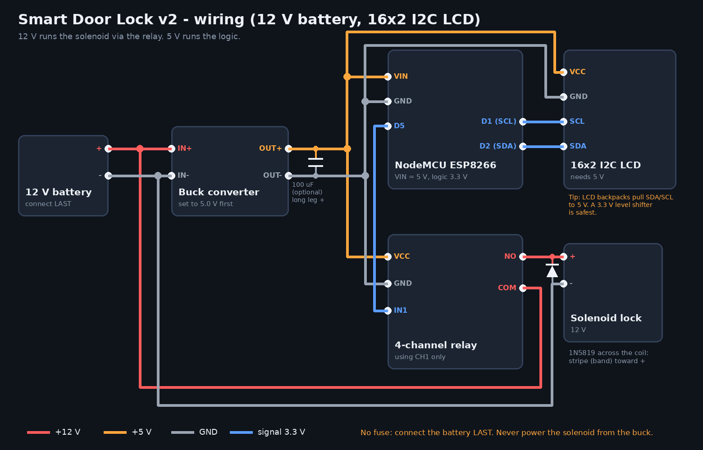
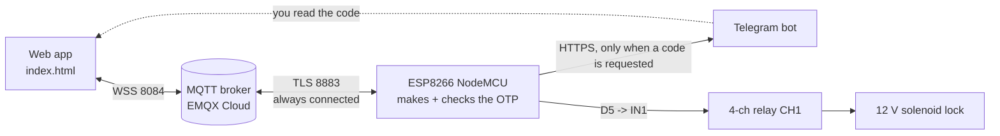
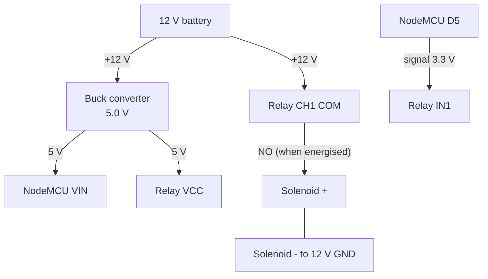

# Smart Door Lock v2

An ESP8266 door lock you unlock from a web app with a one-time code sent to Telegram.
It uses a live MQTT connection instead of polling, so the lock reacts in about **50-150 ms**.



## How it works



1. Tap **Send code**. The web app publishes `{"a":"req"}`.
2. The ESP8266 makes a 6-digit code (hardware RNG) and sends it to your Telegram chat.
3. Type the code. The web app publishes `{"a":"otp","v":"123456"}`.
4. The ESP checks it locally. On a match the relay fires immediately, holds 5 s, then relocks.

## Hardware

| Part | Notes |
|---|---|
| NodeMCU ESP8266 | any ESP-12E dev board |
| 4-channel relay module | only CH1 used; most are active LOW |
| 12 V solenoid lock | |
| 12 V battery | with a charger or solar trickle charger |
| Buck converter | set to 5.0 V before connecting anything; input must accept 15 V or more |
| 1N5819 diode | across the solenoid (any 1 A rectifier diode works) |
| 16x2 I2C LCD | optional; shows Locked / Enter code / Unlocked etc. |
| 100 µF capacitor | optional, across the 5 V rail |
| 2 A fuse | recommended before permanent install |
| Jumper wires | |

### Connections

Plain-text version with a first-power-up checklist: [docs/WIRING.txt](docs/WIRING.txt).

| From | To |
|---|---|
| Battery (+) | Buck IN+ and Relay CH1 **COM** |
| Battery (-) | Buck IN- and Solenoid (-) |
| Buck OUT+ (5 V) | NodeMCU **VIN**, Relay **VCC**, LCD **VCC** |
| Buck OUT- | NodeMCU **GND**, Relay **GND**, LCD **GND** |
| NodeMCU **D5** (GPIO14) | Relay **IN1** |
| NodeMCU **D2** (GPIO4) | LCD **SDA** |
| NodeMCU **D1** (GPIO5) | LCD **SCL** |
| Relay CH1 **NO** | Solenoid (+) |
| 1N5819 | across the solenoid, stripe toward (+) |
| 100 µF (optional) | Buck OUT+ (long leg) and OUT- |



Rules that matter:
- **Common ground.** Buck GND, NodeMCU GND, relay GND, LCD GND and the battery negative must all be connected.
- **Do not power the solenoid from the buck converter or the NodeMCU.** It runs on 12 V directly through the relay.
- **Keep the relay off D0, D3, D4 and D8.** They affect booting. D5 is safe.
- Change `RELAY_ACTIVE_LOW` in the sketch if the lock behaves backwards.

## Setup

1. **Broker (free):** sign up at the [EMQX Cloud console](https://cloud-intl.emqx.com/console/), click **+ New**, choose **Serverless**, keep the **Spend Limit at 0** (free quota only) and deploy.
   - Copy the deployment **Address** (like `abc123.ala.asia-southeast1.emqxsl.com`). This is your `MQTT_HOST`.
   - Ports are fixed: **8883** (firmware, TLS) and **8084** (web app, secure WebSocket).
   - In the deployment menu open **Authentication** (under Access Control) and add a username and password for the lock. Add a second one for the web app if you like.
2. **Telegram:** make a bot with @BotFather and get your chat ID.
3. **Firmware:**
   - Install the ESP8266 board package and the libraries **PubSubClient**, **ArduinoJson v6.21.x** and **LiquidCrystal I2C** (Frank de Brabander).
   - In `firmware/smart_lock_esp8266_mqtt/`, copy `secrets.example.h` to `secrets.h` and fill it in.
   - Open the `.ino`, choose *NodeMCU 1.0 (ESP-12E)* and upload.
   - Serial Monitor at 115200 should show `[MQTT] connected`.
4. **Web app (GitHub Pages):** `index.html` sits at the repo root, so GitHub can host it directly.
   - Push the repo, then go to **Settings → Pages**, set **Source: Deploy from a branch**, **Branch: `main`**, folder **`/ (root)`**, and **Save**.
   - After 1 to 2 minutes the app is at `https://YOUR_USERNAME.github.io/YOUR_REPO/`.
   - Open it on your phone, tap *Connection settings* and enter the broker Address, port `8084`, your credentials and the topic prefix. They are stored in that browser only.

## MQTT protocol

Topic prefix: `lock/<your-secret>`

| Topic | Direction | Payload |
|---|---|---|
| `<prefix>/cmd` | web -> lock | `{"a":"req"}` · `{"a":"otp","v":"123456"}` · `{"a":"lock"}` |
| `<prefix>/evt` | lock -> web | `{"e":"otp_sent"}` · `unlocked` · `locked` · `bad` (+`left`) · `no_otp` · `expired` · `locked_out` · `wait` · `tg_fail` · `low_mem` |
| `<prefix>/status` | lock -> web, retained | `locked` · `unlocked` · `offline` (last will) |

## Troubleshooting

Open Serial Monitor at 115200 and read the `[MQTT] fail rc=...` line.

| rc | Meaning | Fix |
|---|---|---|
| -2 | TCP/TLS failed | Check `MQTT_HOST` (hostname only, no `https://`, no port), port `8883`, and that the cluster is running |
| 4 | Bad username or password | Re-check `MQTT_USER` / `MQTT_PASS`; in EMQX add the credential under Authentication |
| 5 | Not authorised | Give the `esp-lock` credential publish and subscribe permission |
| -4 | Timeout | Weak WiFi, or the network blocks port 8883 (try a phone hotspot) |

LCD blank: turn the contrast trimmer, check SDA on D2, SCL on D1, VCC on 5 V.

## Security

- The OTP is made and checked **on the ESP8266**. The web app and broker never hold the answer.
- 6 digits, expires in 5 min, single use. 3 wrong tries lock the device for 60 s. Code requests are limited to one per 15 s.
- The Telegram OTP message is deleted after use.
- Credentials live in `secrets.h`, which is git-ignored. **Never commit real tokens.** If a token was ever committed (v1 did), revoke it in @BotFather.
- Known limit: TLS uses `setInsecure()` (no certificate check). Pin the broker certificate if you want protection against man-in-the-middle attacks.
- The solenoid is energised for 5 s only. Holding it on for long periods overheats it.

## Project layout

```
.
├── index.html                 the web app (GitHub Pages serves this)
├── firmware/
│   └── smart_lock_esp8266_mqtt/
│       ├── smart_lock_esp8266_mqtt.ino
│       └── secrets.example.h  copy to secrets.h and fill in
├── docs/                      wiring.png, WIRING.txt, DEMO.md, photos/
├── README.md
├── CHANGELOG.md
├── LICENSE
└── .gitignore
```

## License

MIT. See [LICENSE](LICENSE). Replace "Your Name" in the license before publishing.
