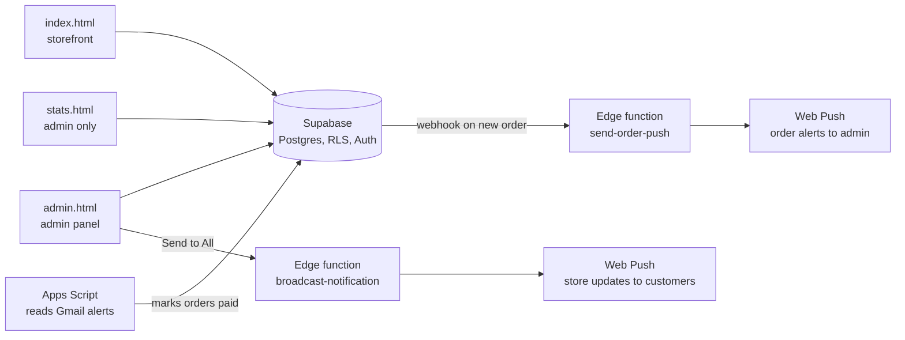
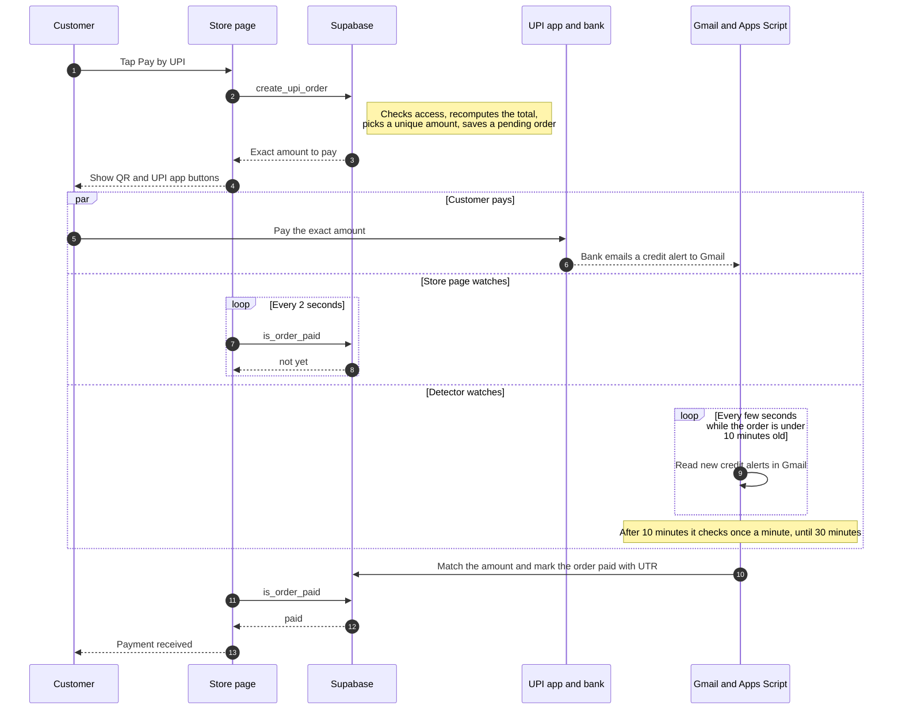
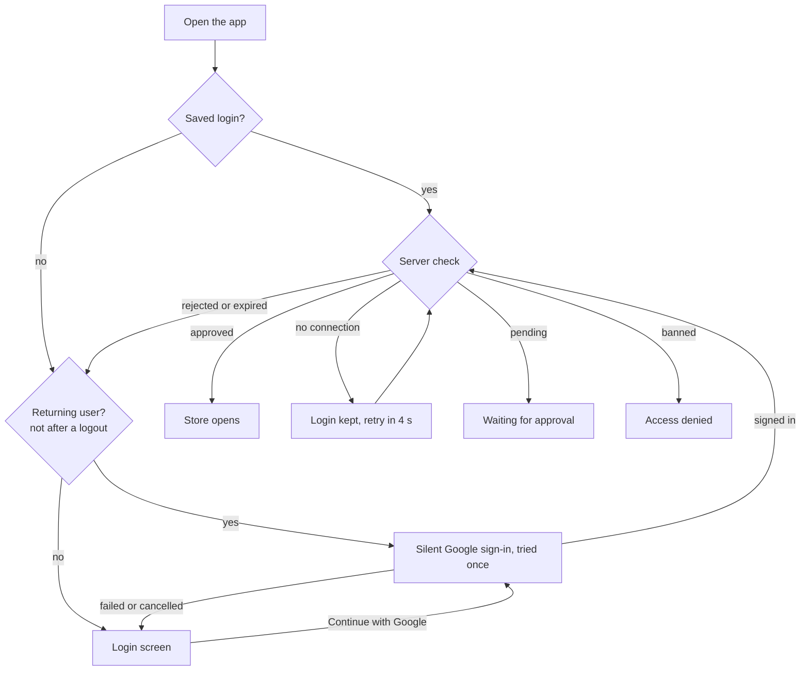
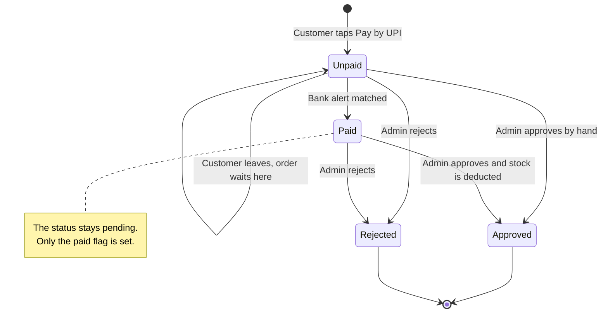
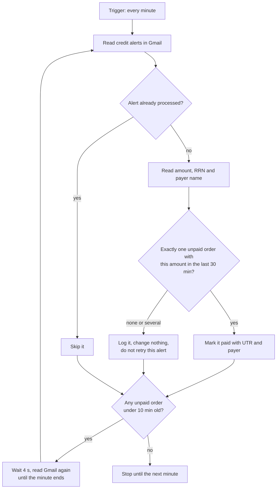
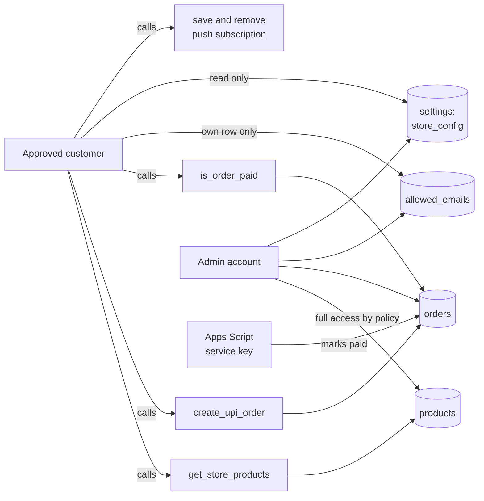

<div align="center">

# Your’s Store

**A members-only mini store with automatic UPI payment detection, built without a backend server.**

[](https://satyam-64136.github.io/My-store/index.html)


**🔗 Live: https://satyam-64136.github.io/My-store/index.html**

</div>

---

## Screenshots

<!-- Add your PNGs to docs/screenshots/ with these names, then delete this comment line and the closing line below.
| Store | Payment | Admin |
|:---:|:---:|:---:|
|  |  |  |
| Product grid with categories | Exact-amount QR + UPI app buttons | Pending orders with PAID · UTR |
-->

> Screenshots go in `docs/screenshots/` (`store.png`, `payment.png`, `admin.png`). The table above is ready to switch on.

---

## What it is

Approved customers sign in with Google, browse the stock, and pay by UPI. The store notices the payment on its own: the bank’s credit-alert email is read by a free Google Apps Script, which marks the order as paid, and the customer’s screen flips to **Payment received** within moments. The admin then approves the order, which deducts stock.

There is no server to host. Pages run on GitHub Pages, data and auth live in Supabase, and the payment detector runs inside Google’s free Apps Script.

## Highlights

**Shopping**
- Product grid with category filters, live stock, out-of-stock dimming and a stock-aware cart
- Floating cart dock, scroll-progress hairline and inertial smooth scrolling (touch stays native)
- A dark, quiet-luxury look: one warm-bone accent, hairline borders, a serif store heading

**Access control**
- Google sign-in gate: anyone can request access, the admin **approves or bans** from the Access tab
- Login that stays saved: survives flaky connections, refreshes tokens quietly, and signs a returning user back in silently if the browser lost the session
- One-tap **Log out** in the top bar
- Store-wide “log everyone out” and open/closed switch; an optional script can close the store automatically each day

**Payments**
- **Exact-amount QR**: every open order gets a unique amount (₹0.01 steps), so one bank email always matches one order
- **Pay with UPI app** buttons for GPay, PhonePe, Paytm and CRED (Android intents, iOS app links)
- **Automatic verification**: Gmail alert → Apps Script → Supabase, checked every few seconds while an order is fresh
- **Resumes after closing the app**: the payment is remembered for 30 minutes and picked back up on reopen
- Totals are recalculated **on the server** from real product prices, so they can’t be edited in the browser

**Admin**
- Pending orders show **PAID · UTR**, who ordered (Google email) and who paid (name on the bank alert)
- Approve or reject, stock +/− controls, sales history and a stats page
- Push notifications for new orders; customers can opt in to store broadcasts via the bell

## How it fits together



## Payment flow

The customer’s screen and the Gmail reader both start watching as soon as the QR appears, so they run side by side with the payment itself.



## Sign-in flow



## Order lifecycle



## How the payment detector decides



## Project structure

```
index.html                 Storefront + payment (view-toggled)
admin.html                 Admin panel, access requests, sales history
stats.html                 Store stats
style.css                  Design system and premium layer
shared.js                  Supabase helpers, Google gate, session handling
sw.js · manifest.json      PWA + push notifications
login-bg.mp4 / .mp3        Login screen media

gmail-payment-detector.gs  Reads bank alerts, marks orders paid
backup-orders-to-sheets.gs Optional: backup approved orders, daily auto-close

sql/                       Run in the Supabase SQL Editor, in this order:
  complete_setup.sql         tables, indexes, base policies
  google-auth-setup.sql      allowed_emails + admin-only policies
  access-requests-upgrade.sql  pending / approved / banned
  push_subscriptions.sql     push subscription storage
  upi_autopay.sql            paid fields, create_upi_order, is_order_paid
  store_products_rpc.sql     hides purchase price from customers
  store_config_fix.sql       lets customers read the open/closed setting
  customer_push.sql          customer notification bell + subscriber list

supabase/functions/
  send-order-push/           Web Push on every new order
  broadcast-notification/    Admin “Send to All” to customers who turned the bell on
```

## Security



- **Row Level Security everywhere.** Customers can’t read or change orders directly; they only call two functions: `create_upi_order` and `is_order_paid`.
- **Prices are trusted server-side.** The order total is recomputed from the products table, never from the browser.
- **Buying cost stays private.** Customers load products through `get_store_products`, which returns public columns only.
- **Secrets stay out of the repo.** The Supabase service-role key lives only in Apps Script’s script properties and Edge Function secrets.
- **Admin is locked to one account** by database policy, not just by the interface.

## Setup

1. **Supabase.** Create a project, enable the **Google** provider (Authentication → Providers), then run the SQL files in the order above.
2. **Config.** Put your project URL and publishable key in `shared.js`, and your receiving UPI ID in `index.html` (`UPI_ID`).
3. **Hosting.** Push to GitHub and enable Pages. Add `icon-192.png`, `icon-512.png` and the two `-maskable` versions for the installable admin app.
4. **Payment detector.**
   - Open script.google.com signed in as the Gmail that receives the bank alerts and paste in `gmail-payment-detector.gs`.
   - Add the script property `SB_SERVICE_KEY` (Supabase service-role key).
   - Run `install()` once and accept the permissions.
   - If your bank isn’t Kotak, change `GMAIL_QUERY` to its sender and subject.
5. **Push alerts (optional).** Deploy `send-order-push`, set the VAPID secrets, and add a Database Webhook on `orders` INSERT. For the customer bell, run `customer_push.sql` and deploy `broadcast-notification` (it reuses the same VAPID secrets).

## Good to know

- **The receiving UPI ID matters.** It must belong to the account that sends the alert emails, otherwise nothing is detected.
- **Verification speed depends on the bank’s email.** The script checks every few seconds, but it can’t see a payment before the email arrives.
- **UPI apps can warn on links to personal UPI IDs.** The QR is the fallback, and a merchant UPI ID is the lasting fix.
- **Apps Script has a daily runtime quota** (about 90 minutes on free accounts). The detector only runs fast while an unpaid order is fresh.
- **Customers may pay up to ₹0.99 extra** so that every open order has its own amount. The screen always shows the exact figure.
- **Orders still need admin approval** before stock is deducted. A paid order just arrives with proof attached.

---

<div align="center">

Built by **Satyam** · DIT University, Dehradun

</div>
